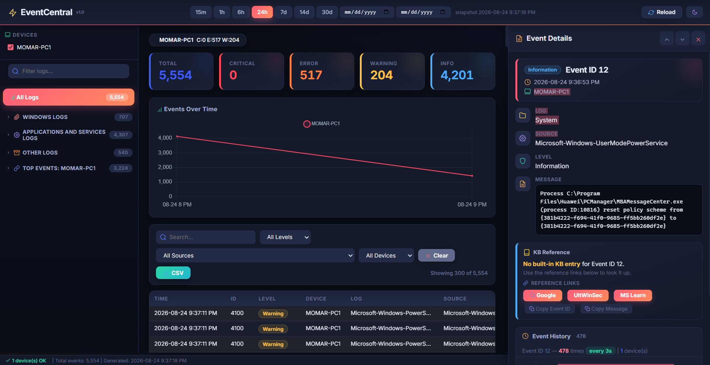

<div align="center">

# 📊 EventCentral

**Multi-Device Event Monitor**

Collect Windows Event Logs from this PC and remote servers over WinRM, keep them in a local archive, and browse them in a dashboard opened in your browser.

[](#-usage)
[](https://learn.microsoft.com/en-us/powershell/)
[](#%EF%B8%8F-requirements)
[](#-overview)
[](#-license)
[](#-overview)

[Overview](#-overview) • [Features](#-core-features) • [Usage](#-usage) • [Architecture](#%EF%B8%8F-architecture) • [Troubleshooting](#-troubleshooting) • [License](#-license)

</div>

---

# 📖 Overview

EventCentral gathers Windows Event Logs from the local machine and remote servers through WinRM, finds all event logs on each device, and shows them in an interactive browser dashboard. Each scan adds new events to the archive and keeps the old ones.

> No agents, no database server, and no package installs. All files stay on your machine.

---

## 🖼️ Screenshots



*Dashboard with summary cards, a per-device timeline, a collapsible log tree, device health chips, and the sortable event table.*

---

# ✨ Core Features

### 🔹 Collection Engine
* Each scan covers a look-back window, and devices that fell behind resume from their saved position. Events are not skipped
* `events.json` keeps growing. Scans merge new rows instead of deleting old ones
* A unique key made from time, EventID, Log, Machine, and an MD5 hash of the message prevents duplicates, including events in the same second
* Collect from localhost and remote servers with `Invoke-Command` over WinRM
* `Get-WinEvent -ListLog *` finds every log that holds events
* Pick a scope: Basic for standard logs, Advanced to add service logs, or All for every log
* Remote errors are labeled as ACCESS DENIED, WINRM NOT ENABLED, TIMEOUT, or NETWORK ERROR
* If a device fails, its scan position is kept so the missed window is collected next time

### 🔹 Dashboard
* Summary cards for total, critical, error, warning, and info events
* Time presets from 15 minutes to 30 days, plus custom date pickers
* A Chart.js timeline with events per hour per device. Hover to filter, click to pin
* A sortable, filterable table with infinite scroll
* A level dropdown that only lists levels present in the data, in canonical order
* A sidebar with a collapsible log tree and live search, laid out like Event Viewer
* Device health chips in green, orange, and red based on thresholds
* Detection of the same Event ID appearing on several devices
* Event History: click an event to see all its past occurrences and the average gap between them
* Around 70 built-in references for common Windows Event IDs
* Light and dark themes, remembered in `localStorage`
* CSV export for the filtered rows
* Keyboard shortcuts: `Ctrl+F` to search, `Ctrl+E` to export, `Esc` to close

### 🔹 Data & Storage
* `events.json` is the archive. The dashboard reads it first and refreshes from it
* The HTML also carries an embedded snapshot, so it works offline from `file://`
* `last_scan.json` stores the scan position for each device

---

# 📂 Project Structure

```text
EventCentral-Dashboard/
│
├── EventCentral-Collector.ps1     # Event collection job
├── Run-EventCentral.ps1           # Launcher / scheduler
├── EventCentral-Dashboard.html    # Interactive browser dashboard
├── events.json                    # Event archive
├── last_scan.json                 # Last scan metadata
├── Screenshot.png                 # Documentation screenshot
└── README.md
```

---

# 🚀 Usage

```powershell
.\Run-EventCentral.ps1
```

You can also double-click **Run-EventCentral.ps1** in File Explorer.

### Steps

1. Open `Run-EventCentral.ps1` and edit the `⚙️ YOUR SETTINGS` section for devices, hours, scope, and thresholds
2. Run the launcher. It collects events and opens the dashboard
3. Filter by time, log, device, or level. Click any event for details and history
4. Press `Ctrl+E` to export the filtered rows to CSV

### Configuration Examples

```powershell
# Monitor two remote servers, last 48 hours
.\Run-EventCentral.ps1 -ComputerNames SRV01,SRV02 -Hours 48

# More events per log, advanced scope
.\Run-EventCentral.ps1 -ScanScope Advanced -MaxEventsPerLog 1000

# Skip updating the dashboard HTML
.\Run-EventCentral.ps1 -SkipRefresh

# Custom health thresholds
.\Run-EventCentral.ps1 -CriticalThreshold 3 -ErrorThreshold 10
```

Command-line options override the values in the settings section.

---

# ⚙️ Requirements

| Requirement | Details |
|-------------|---------|
| **OS** | Windows 10 / 11 / Server 2016+ |
| **PowerShell** | 5.1 or later |
| **Permissions** | Administrator, for the Security log and remote scans |
| **Remote servers** | WinRM enabled: `Enable-PSRemoting -Force` |
| **Browser** | Chrome, Edge, or Firefox |
| **Network** | Internet once, to load Google Fonts and Chart.js from their CDN |

---

# 🏗️ Architecture

```text
EventCentral-Dashboard/
├── Run-EventCentral.ps1           # Launcher + config (edit this one)
├── EventCentral-Collector.ps1     # Collection engine
├── EventCentral-Dashboard.html    # Interactive dashboard UI
├── events.json                    # Event archive (generated)
├── last_scan.json                 # Scan state (generated)
└── README.md                      # This file
```

### Data Flow

```text
Devices (local + WinRM)
        │
        ▼
EventCentral-Collector.ps1 ────► events.json ◄──── (database)
        │                              │
        └──► EventCentral-Dashboard.html ──► Browser
             (embedded snapshot for file://,
              live fetch for http://)
```

### Auto-Detection Behavior

* Every log with events is found through `Get-WinEvent -ListLog *`
* If no devices are configured, the local machine is used
* Numeric event levels become Critical, Error, Warning, Information, or Verbose
* DNS suffixes are stripped and names uppercased, so `pc-1.corp.local` and `PC-1` count as one device
* When refresh is enabled, the HTML is updated with the new data after each collection

---

# 🔍 Troubleshooting

| Symptom | Likely Cause | Fix |
|---------|--------------|-----|
| Remote scan: ACCESS DENIED | Not running as Administrator | Run the launcher elevated |
| Remote scan: WINRM NOT ENABLED | Remoting off on the target | Run `Enable-PSRemoting -Force` on the target |
| Remote scan: TIMEOUT | Target offline or firewalled | Run `Test-NetConnection <host> -Port 5985` |
| Security log empty | Missing admin rights | Run elevated. The Security log needs admin |
| Dashboard shows old data | `-SkipRefresh` was used | Re-run without it, or open the HTML to re-embed the data |
| Fonts or charts missing | No internet on first load | Chart.js and Google Fonts load from a CDN once, then cache |

---

# 🛡 Operational Notes

* `events.json`, the dashboard, and the scan state are local files. No telemetry or cloud service is involved
* Run elevated only when you need the Security log or remote scans. The collector reads logs and does not change system state
* Enable WinRM only on trusted hosts, and scope firewall rules to your management subnet
* `events.json` grows by design. Archive or rotate it if disk space becomes a concern
* Try the scan scope and thresholds on a pilot device before pointing the tool at production servers

---

## 👤 Author

**Mohammad Abdelkader Omar**  
GitHub: [@mabdulkadr](https://github.com/mabdulkadr)  
Website: [momar.tech](https://momar.tech)  

---

## 📜 License

This project is licensed under the [MIT License](LICENSE).

---

## ⚠ Disclaimer

This skill and every script it generates are provided as-is with no warranty
of any kind. Test generated tools in a staging environment before deploying to
production. The authors assume no liability for any damage or data loss
resulting from their use.

---
<div align="center">

⭐ **If this tool saves you time, star the repo — it helps others find it.**

[Report an Issue](../../issues) · [momar.tech](https://momar.tech)

[](https://www.buymeacoffee.com/mabdulkadrx)

Built with [**PowerShell Enterprise Admin**](https://github.com/mabdulkadr/powershell-enterprise-admin-skill)

</div>
